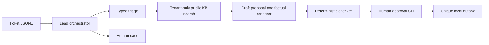

# Project Relay

A local support desk for Northwind Cycles and Harbor Dental. Models propose classifications and drafts; Python and PostgreSQL enforce routing, isolation, budgets, safety checks and human approval. No external message is actually sent.



## Quickstart from a clean clone

Prerequisites: Python 3.11+, Git, Docker running with Linux containers, and Ollama running locally. On Windows use Docker Desktop with WSL2; the bootstrap script also works from Windows PowerShell. Python 3.12 was used for the measured Windows runs.

```sh
git clone https://github.com/suhani954/nmg_task.git
cd nmg_task
ollama pull qwen2.5:1.5b
ollama pull nomic-embed-text
python scripts/demo.py
```

On Linux use `python3 scripts/demo.py` if `python` is not installed. `make demo` is equivalent when make is installed. Downloads and local inference can be slow; keep the terminal open. The script starts Postgres, creates a virtual environment, installs dependencies, migrates, seeds both KBs with real embeddings, processes both inboxes, exports decisions and lists pending approvals. It never approves messages automatically. Repeated demo runs reuse seeded data and do not create duplicate tickets or decisions.

The brief's standalone preflight `relay-pg` container is reused when already running on port 5432. Otherwise Docker Compose starts the database. If another application owns that port, choose PG_PORT and matching DATABASE_URL/ADMIN_DATABASE_URL values; `.env.example` lists all options. No API key is required. Credentials in the example are local development credentials, and the database port is bound only to loopback.

For subsequent commands, activate the virtual environment:

```sh
# Linux / WSL
. .venv/bin/activate
# Windows PowerShell, instead of the line above
.venv\Scripts\Activate.ps1
```

If PowerShell blocks activation, replace `python` in commands below with `.venv\Scripts\python.exe`. Make targets automatically select the created virtual environment.

```sh
python -m relay list --tenant northwind
python -m relay show --tenant northwind NW-T01
python -m relay approve --tenant northwind NW-T01 --by YOUR_NAME
python -m relay reject --tenant northwind NW-T03 --by YOUR_NAME --reason "Clarify the missing evidence"
python -m relay worker
make run INBOX=data/northwind/tickets.jsonl
make eval RUNS=3
make test
```

Without make: `python -m relay run --inbox FILE`, `python -m relay eval --runs 3`, and `python -m pytest -q`.

Approve only after reading the specific pending text. Approval is idempotent and writes `out/outbox.jsonl` through a unique database row. No email, refund, appointment change or records transfer occurs. `out/decisions.jsonl` contains one latest decision per tenant/ticket; every revision remains in the database audit/approval history. Decision status is the model-processing snapshot; later human approval status is separate.

## Hardware and measured results

Test laptop: HP 14q-cs0xxx, Intel Core i3-8130U, 7.9 GB RAM, Windows with WSL2 and Docker Desktop; no GPU was required. Initial free disk was approximately 40 GB.

Default runtime models: qwen2.5:1.5b for both triage and drafting, nomic-embed-text for 768-dimensional embeddings. An initial llama3.2:3b drafting attempt caused substantial memory pressure; the brief permits using 1.5B for additional steps. Models are retained for five minutes by default to avoid repeated loads; set MODEL_KEEP_ALIVE=0 for a lower-memory trade-off.

Measured demo timing and evaluation outcomes are recorded in docs/VALIDATION.md and docs/EVAL.md when their runs finish. Do not infer a passing result from this paragraph. Initial implementation tests passed; final validation evidence is recorded separately. Evaluation uses three runs under the brief's slow-laptop allowance.

## Requirement status

| ID | Status | Evidence or limitation |
|---|---|---|
| C1 | partial | One-command bootstrap implemented; final clean-clone timing belongs in VALIDATION.md. |
| C2 | done | Typed contracts, narrow agent contexts, one repair then classified failure. Final factual wording is deliberately extractive. |
| C3 | done | pgvector cosine retrieval through tenant-bound app sessions. |
| C4 | partial | Required deterministic checks implemented and tested; medical/identifier patterns and content fingerprints are finite, not universal detection. |
| C5 | done | List/show/approve/reject, one human redraft, transactional unique outbox and audit history. |
| C6 | done | Restricted app role, FORCE RLS, transaction-local tenant, fail-closed and cross-tenant tests. |
| C7 | done | Typed JSONL decisions, arbitrary same-format input, composite idempotency and regenerated exports. |
| E1 | done | Central gateway, actual token counts/latency, atomic budget reservations and held_budget. |
| E2 | done | SKIP LOCKED leases, fencing tokens, bounded backoff/jitter, cases and operator recovery. |
| E3 | partial | Real repeated evaluation is running; final artifacts and measurements determine completion. |
| E4 | done | No-Ollama test suite, including real Postgres isolation/approval tests and a fake deterministic model. Integration tests require Postgres. |
| S1 | not done | No provider circuit breaker or chaos/fallback route. |
| S2 | not done | CLI approval views only; no internal/client analytics reports or web UI. |
| S3 | done | GitHub Actions test workflow included; the d085d3a milestone completed successfully on GitHub. |
| S4 | partial | Scaling design documented; no current priced hosting estimate. |

## Assumptions and limits

- Clinical requests always escalate; human cases identify dentist routing. Automated emergency advice is not produced. This interpretation leaves a documented gap against the brief's emergency-guidance sentence.
- A second human rejection creates a case. Automated supersession of an unsafe earlier draft does not count as a human rejection.
- An ordinary thank-you can be acknowledged with no KB citation, but the small triage model may still misclassify it.
- Unknown tenants are rejected into a sanitized record rather than a fabricated known-tenant decision.
- Input bodies longer than 30,000 characters are rejected with an input-validation record.
- A trusted operator can select either tenant. Authentication and tenant-user authorization are not implemented.
- Combined submission exports contain both fictional companies for the evaluator. They are operator artifacts, not a tenant-facing report.
- A valid citation does not prove that retrieval selected the right policy. Routing and coverage can be wrong; see the actual evaluation errors.
- Budget reservations are conservative and may hold work earlier than actual consumption would require.

See docs/ARCHITECTURE.md, docs/DECISIONS.md, docs/RUNBOOK.md, docs/LIMITATIONS.md and docs/AI_USAGE.md. The generated outputs must not be edited by hand. Golden labels are used only in evaluation.py.

## Time and submission

First commit: 2026-10-28 13:53:29 IST. Setup and model downloads occurred before it. Final elapsed time, tag and validation evidence are recorded in docs/VALIDATION.md. The candidate must make the required 3–5 minute recording and submit its link with the repository URL, tag SHA, start/end times and laptop specifications.
