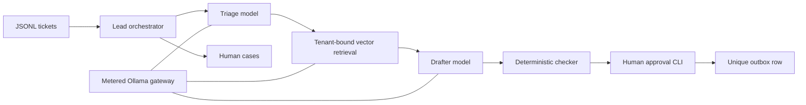
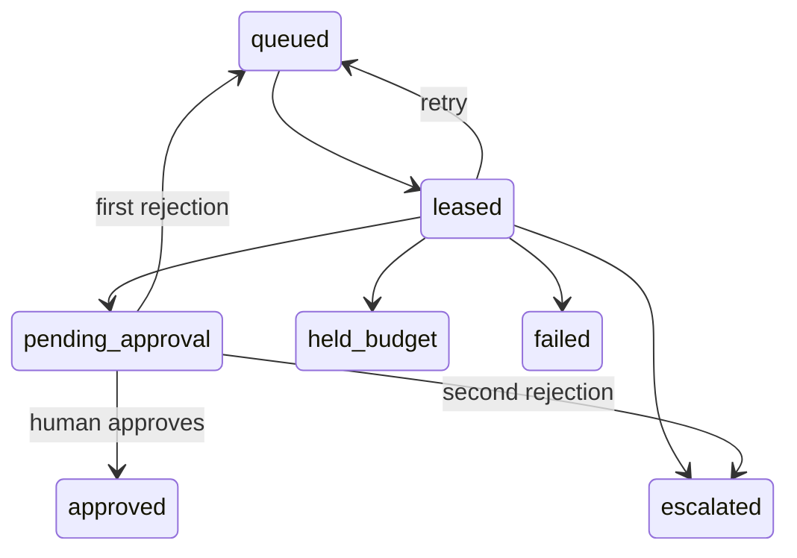

# Architecture

The lead is an explicit Python state machine. It does not delegate irreversible actions to a model. Every model response is a typed proposal, checked with Pydantic before routing or persistence.

## Contracts and context

`Ticket` validates tenant, identifiers, timestamp and input size. `TriageResult` provides category, priority, action, injection flag, reason and missing details. Triage sees subject and body only. Retrieval receives the ticket and a transaction-bound database session, returning `Passage` objects with ID, public text and cosine similarity. The drafter sees only the ticket, routing result and most relevant public passage, returning `DraftResult`. A deterministic factual renderer uses the public policy wording rather than allowing invented model prose into the final reply. The checker is deterministic and has no model access. `DecisionRecord` enforces Appendix B.

Structured calls use Ollama's JSON schema interface. Invalid output gets one schema repair request without echoing the malformed response. A second invalid response becomes `invalid_model_output`. Provider failures use bounded durable retries instead.

Ambiguous injection flags receive a second typed semantic review using ticket text only. Legal complaints and clinical questions still escalate when required, but are not automatically considered attacks. Direct injection patterns cannot be cleared by this review. An unsupported request categorized as `other` escalates even if vector similarity is high. A narrowly recognized acknowledgment may receive a fixed thank-you reply, after injection checks and with action/clinical terms excluded.

Repeated evaluation runs reuse immutable public retrieval passages keyed by tenant and exact ticket text. Every run still performs fresh triage inference, any required injection review, and routing. No model answer or decision is cached. This measures triage/routing stability, not repeated embedding variability; recorded usage counts only calls actually made.

## Data model and transaction boundaries

`kb` holds vector(768) embeddings and public/internal flags. `tickets` stores validated input and workflow state. `jobs` holds attempts, lease token, expiry and next retry time. `decisions` holds one current decision snapshot per tenant/ticket. `approvals` stores versioned reviewable drafts. `outbox` has both a composite primary key and unique idempotency key. `cases` records owner, severity and classified reason. `audit` records actor, time, event and reason. `model_calls` stores usage and latency without prompts or response bodies. `runs` stores shared budget reservations. Invalid inputs receive a sanitized `rejected_inputs` record without their body or unknown tenant value.

Ingestion inserts a ticket, job and audit event atomically. Workers claim jobs using `FOR UPDATE SKIP LOCKED` and commit before model calls. Completion locks the job and checks the lease token; a stale worker cannot publish its result. A replacement worker can reclaim an expired lease. Transient errors schedule exponential backoff with jitter, and exhausted attempts become a human case and failed decision. No customer send occurs during a model call.

## Approval state machine

Approval locks the ticket and current draft, rechecks the text, writes the unique outbox row and audit event in one transaction. Repeating an approval returns `already approved`. The first rejection creates revision 1 through the durable job. The second rejection opens a case. Decisions are snapshots of model processing; approval state and audit history remain in their own tables. JSONL files are atomic snapshots regenerated from database rows, never append-only sources of truth.

## Tenant isolation

The app uses `relay_app`, a non-superuser without BYPASSRLS. All tenant tables have ENABLE and FORCE ROW LEVEL SECURITY, with both USING and WITH CHECK policies. A per-transaction `set_config('app.tenant_id', tenant, true)` establishes context. Missing or empty context returns zero rows. The allowlist rejects unknown tenants before a tenant session is opened. Integration tests prove reads and writes are isolated, and a later context-free transaction sees no rows.

The operator CLI is privileged to select either known tenant; it is not an authenticated multi-user SaaS frontend. Combined submission exports are operator artifacts containing both companies by design. Client-facing contexts never receive those combined exports. The trusted checker uses seeded forbidden-content fingerprints from the other company solely for leak detection; these are never passed to models or included in error reasons.

## Safety and budgets

Internal articles are excluded in the retrieval SQL. The checker validates tenant-owned public citations and retrieved IDs, rejects canary references, matching private text fragments, other-company names/content, unexpected customer identifiers, clinical language and replies longer than 150 words. Triage combines semantic detection with deterministic injection and safety overrides. No guarantee is claimed against every adversarial paraphrase.

All chat and embedding requests go through `Gateway`. Atomic reservations lock run before ticket, conservatively bound input bytes plus framing/schema overhead and reserve maximum output tokens. Successful calls reconcile against Ollama's actual counters. Provider failures retain their reservation because consumption is unknown. Seed embeddings are metered in a separate run. Budget exhaustion becomes `held_budget`; no approval is created. Local inference uses temperature 0, fixed seed and retains the small models for five minutes to reduce repeated loads. MODEL_KEEP_ALIVE=0 unloads after each request when memory is tighter.

